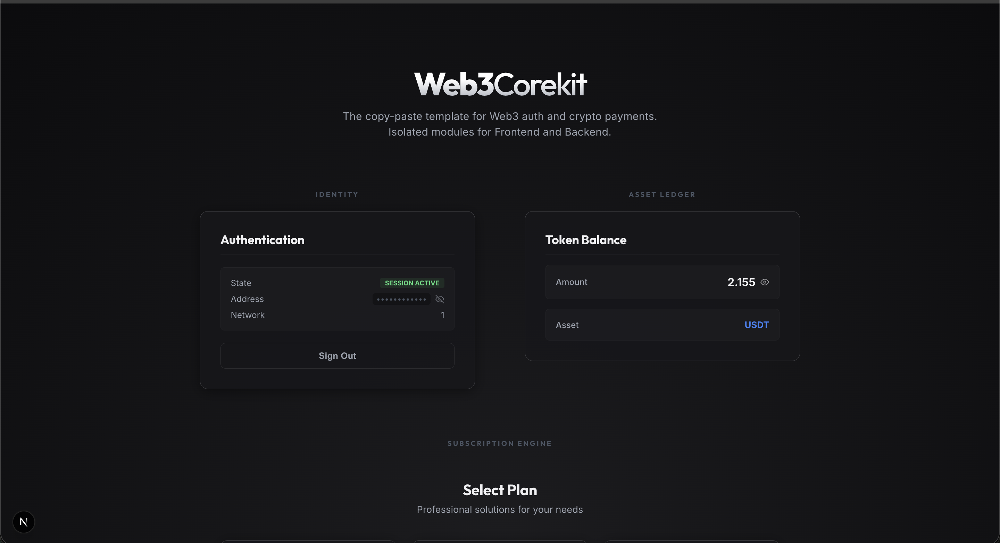
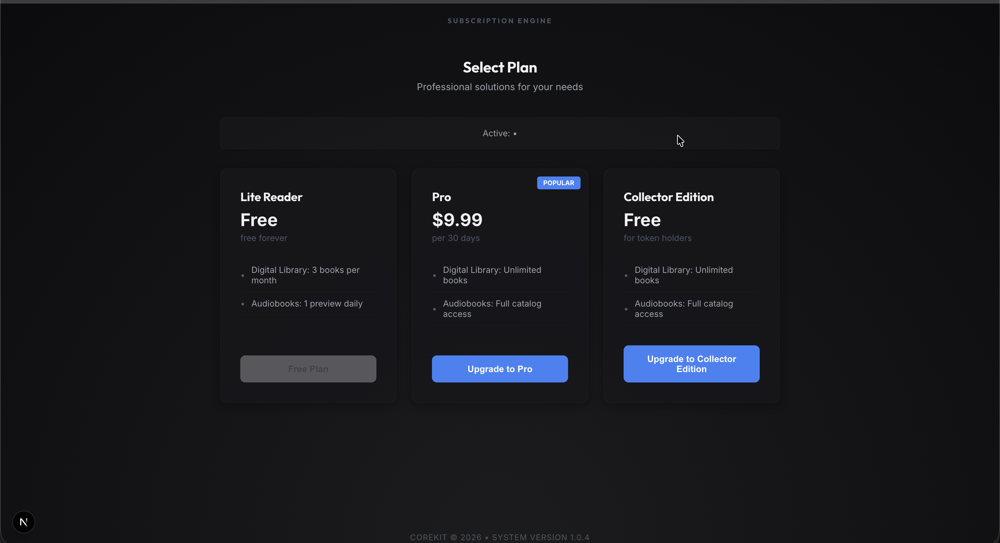

# web3-corekit

A copy-paste template for Web3 wallet auth, crypto payments and token gating,
split into one-file modules for a Next.js frontend and a FastAPI backend.




Building Web3 features from scratch is repetitive. Here each core feature is an
independent module: copy the backend file and the matching frontend component
you need, and drop the rest.

## What it does

- **SIWE auth**: Sign-In with Ethereum through Reown AppKit (WalletConnect).
  Nonce, signature verification and a 48-hour session in an httponly cookie.
  Create a project ID in the [Reown Dashboard](https://dashboard.reown.com/).
- **Crypto payments**: plans (example: free tier, paid "Pro", and a token-holder
  tier), invoices through NowPayments, and an IPN webhook verified with
  HMAC-SHA512. Subscription status is stored in the database layer.
- **Balance check / token gating**: reads an ERC-20 `balanceOf()` through
  Alchemy (Ethereum mainnet), cached in 5-minute windows. `is-holder` tells you
  whether a wallet holds at least `MIN_HOLDER_BALANCE`, so you can grant a
  holder tier without a payment.

### Modules

| # | Backend | Frontend | What it does |
|---|---------|----------|-------------|
| 1 | `modules/auth.py` | `AuthModule.tsx` | SIWE wallet auth (Reown/WalletConnect) |
| 2 | `modules/crypto_payment.py` | `CryptoPaymentModule.tsx` | One-time crypto payments + plans |
| 3 | `modules/balance_check.py` | `BalanceCheckModule.tsx` | ERC-20 token balance via Alchemy |

Auth is shared: modules 2 and 3 import `require_auth` from it.

## Tech stack

- **Backend**: Python 3.10+, FastAPI, Uvicorn, eth-account, web3.py, requests
- **Frontend**: Next.js (pages router) + TypeScript, React, Reown AppKit
  (`@reown/appkit`, `@reown/appkit-adapter-wagmi`, `@reown/appkit-siwe`),
  wagmi, viem, TanStack Query
- **Storage**: in-memory mock DB (`backend/services/mock_db.py`); swap it for a
  real database before production
- **Integrations**: Reown (WalletConnect), NowPayments, Alchemy

## Getting started

Requirements: Python 3.10+ and Node.js 20.9+ (required by Next.js 16).

### Backend

```bash
cd backend
cp .env.example .env    # fill in your own values
pip install -r requirements.txt
python app.py           # http://localhost:9000
```

In `app.py`, comment out any module you don't need:

```python
register_module("modules.auth", "/api")              # Required
register_module("modules.crypto_payment", "/api")     # Optional
register_module("modules.balance_check", "/api")      # Optional
```

### Frontend

The frontend reads its `NEXT_PUBLIC_` variables from the backend `.env` via a
symlink:

```bash
cd frontend
ln -sf ../backend/.env .env
npm install
npm run dev             # http://localhost:3000
```

In development the frontend calls the backend at `http://localhost:9000`
(`src/configs/baseConfig.js`); in production it uses relative URLs, so serve
both behind the same domain. The backend CORS list allows
`http://localhost:3000` and `http://127.0.0.1:3000`.

### Environment variables

All variables live in `backend/.env` (see `backend/.env.example`):

| Variable | Used by |
|---|---|
| `HOST`, `PORT`, `DEBUG` | `app.py` (defaults `0.0.0.0`, `9000`, `false`; `DEBUG=true` enables reload) |
| `IS_DEVELOPMENT` | auth (non-secure cookies in development) |
| `NOWPAYMENTS_API_KEY`, `NOWPAYMENTS_IPN_SECRET` | crypto payments |
| `DOMAIN_URL`, `FE_DOMAIN_URL` | crypto payments (callback and redirect URLs) |
| `ALCHEMY_KEY`, `TOKEN_CONTRACT`, `TOKEN_DECIMALS`, `MIN_HOLDER_BALANCE`, `TOKEN_SYMBOL` | balance check / holder tier |
| `NEXT_PUBLIC_REOWN_PROJECT_ID`, `NEXT_PUBLIC_REOWN_APP_NAME`, `NEXT_PUBLIC_REOWN_APP_DESCRIPTION`, `NEXT_PUBLIC_REOWN_APP_URL`, `NEXT_PUBLIC_REOWN_DOMAIN` | frontend (Reown AppKit + SIWE) |
| `TEST_USER_WALLET_ADDRESS` | optional, `scripts/simulate_webhook.js` |

### Tests

Smoke tests for all three backend modules (FastAPI `TestClient`, no external
calls needed). Run from the repo root:

```bash
pip install pytest httpx
python -m pytest test_smoke.py -v
```

### Simulating a payment webhook

`scripts/simulate_webhook.js` sends signed NowPayments IPN payloads to your
local backend, using `NOWPAYMENTS_IPN_SECRET` and `TEST_USER_WALLET_ADDRESS`
from `backend/.env`. It needs `axios` and `dotenv`:

```bash
npm install --no-save axios dotenv   # from the repo root
node scripts/simulate_webhook.js
```

## Routes

| Route | Module | Auth? |
|-------|--------|-------|
| `GET /health` | app | no |
| `GET /api/nonce` | auth | no |
| `POST /api/verify` | auth | no |
| `GET /api/session` | auth | yes |
| `POST /api/signout` | auth | yes |
| `GET /api/status` | auth | no |
| `GET /api/crypto/plans` | crypto_payment | no |
| `GET /api/crypto/my-subscription` | crypto_payment | yes |
| `POST /api/crypto/create-invoice` | crypto_payment | yes |
| `POST /api/crypto/webhook` | crypto_payment | no (IPN signature) |
| `GET /api/crypto/user-plan` | crypto_payment | yes |
| `GET /api/balance` | balance_check | yes |
| `GET /api/is-holder` | balance_check | yes |

## Swapping auth

Replace `modules/auth.py` with any module that exports a `require_auth` FastAPI
dependency returning `{"address": "...", "chain_id": "..."}`.

## Project structure

```
web3-corekit/
├── backend/
│   ├── app.py                 # FastAPI app, CORS, module registration
│   ├── modules/
│   │   ├── auth.py            # SIWE auth + require_auth dependency
│   │   ├── crypto_payment.py  # plans, NowPayments invoices, IPN webhook
│   │   └── balance_check.py   # ERC-20 balance + holder check via Alchemy
│   ├── services/mock_db.py    # in-memory key-value store
│   ├── requirements.txt
│   └── .env.example
├── frontend/
│   ├── src/
│   │   ├── pages/             # _app.tsx, index.tsx (demo page with all modules)
│   │   ├── modules/           # AuthModule, CryptoPaymentModule, BalanceCheckModule
│   │   ├── components/        # AppKitProvider (Reown + wagmi + SIWE config)
│   │   ├── hooks/useReown.tsx
│   │   └── configs/           # API base URL, Reown settings
│   ├── package.json
│   └── tsconfig.json
├── scripts/simulate_webhook.js
├── docs/DEVELOPER_GUIDE.md    # module internals, plans, webhook security
├── DEPLOYMENT.md              # production .env and webhook setup
└── test_smoke.py
```

## Notes

- The mock DB is in memory: sessions, nonces and subscriptions are lost on
  restart.
- For deployment, see [DEPLOYMENT.md](DEPLOYMENT.md). Point the NowPayments IPN
  callback at `https://<your-domain>/api/crypto/webhook`.

## License

[MIT](LICENSE)
